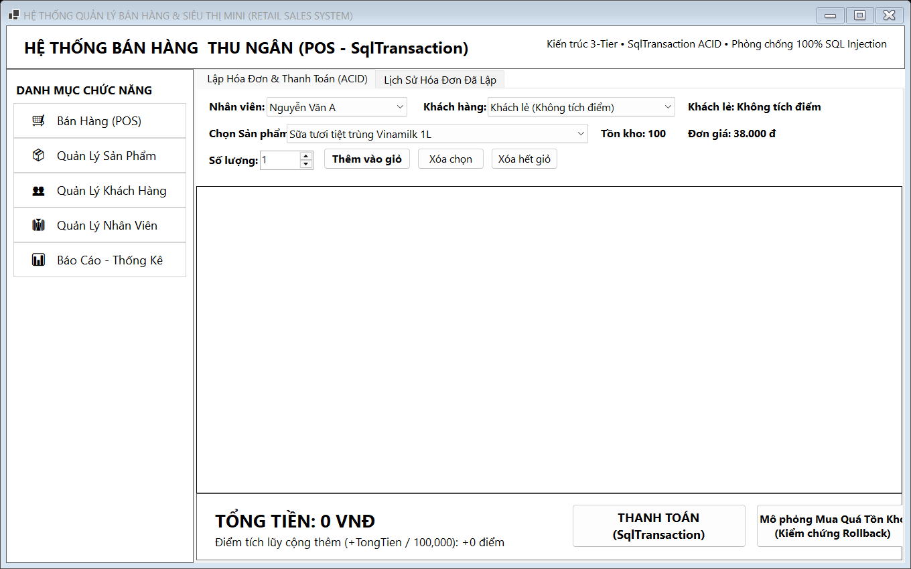
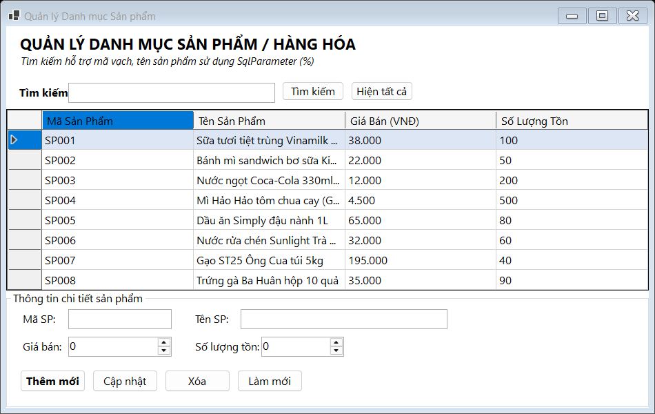
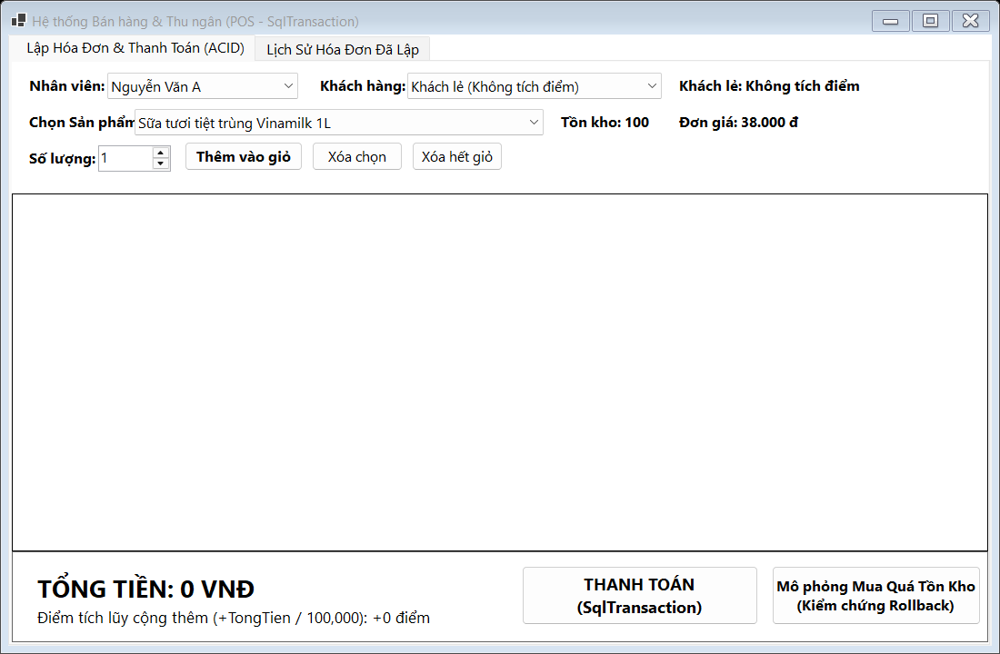
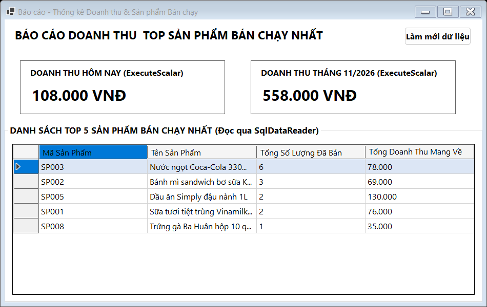
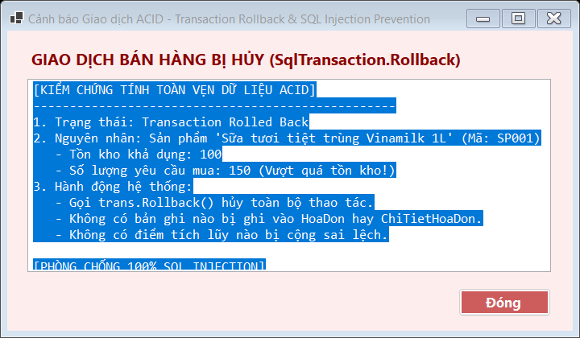
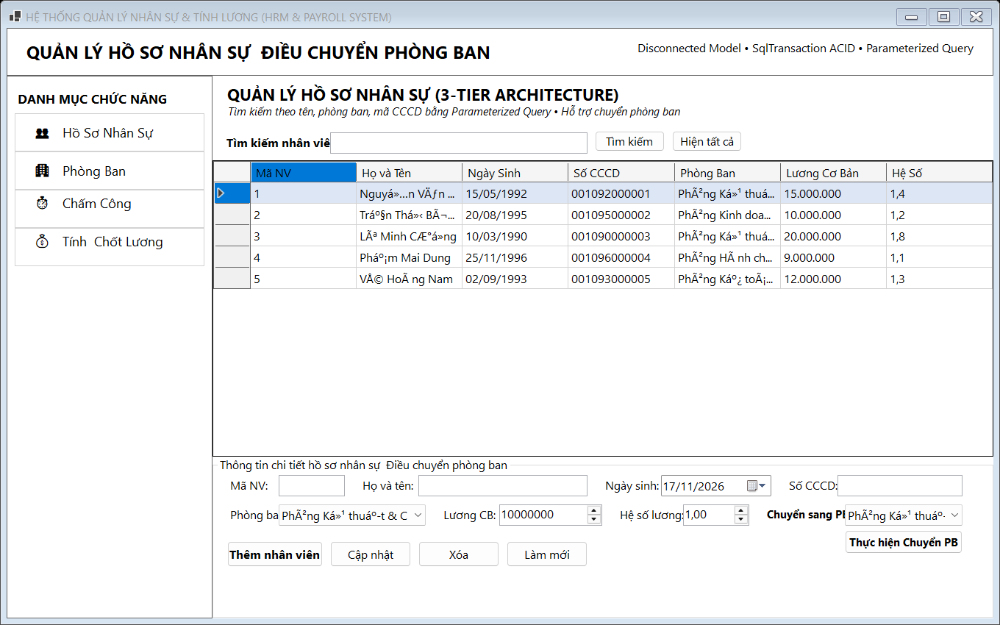
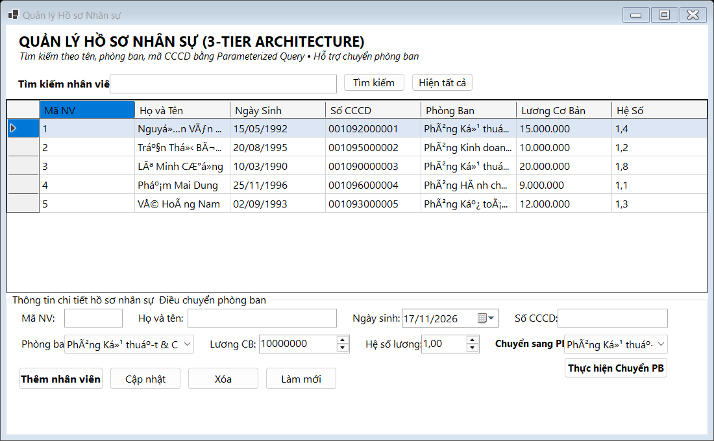
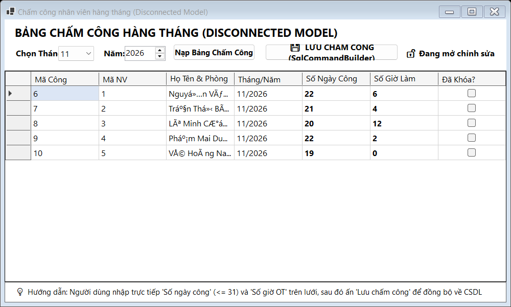
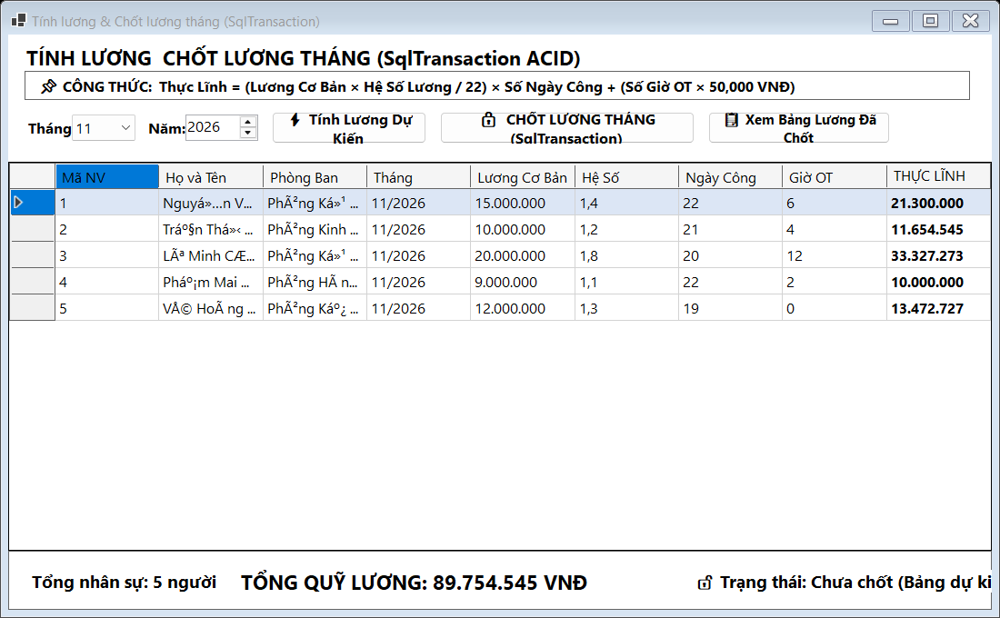
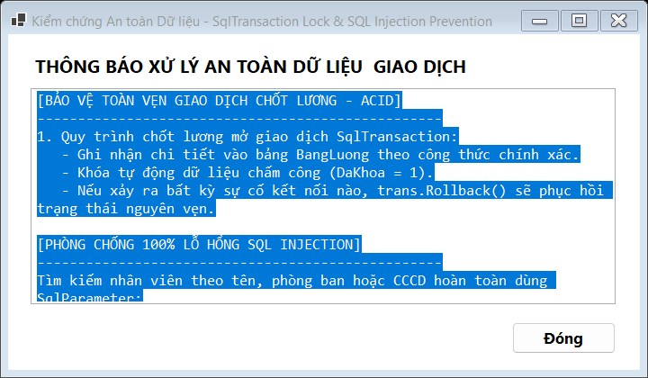

# BÁO CÁO THỰC HÀNH WINDOWS FORMS - BÀI TẬP 6.1 & 6.2

## MỤC 1: THÔNG TIN SINH VIÊN
- **Họ và tên sinh viên:** Trịnh Minh Hưng
- **Mã sinh viên:** 24810310276
- **Lớp :** D19CNPM3

---

## MỤC 2: HÌNH ẢNH KẾT QUẢ CÁC MÀN HÌNH CHỨC NĂNG

### 1. BÀI TẬP 6.1: HỆ THỐNG QUẢN LÝ BÁN HÀNG & SIÊU THỊ MINI (RETAIL SALES SYSTEM)

1. **Màn hình Chính / Tổng quan hệ thống:**
   

2. **Màn hình Quản lý Danh mục (CRUD - Thêm/Sửa/Xóa):**
   

3. **Màn hình Thực thi Nghiệp vụ chính (Lập Hóa đơn / Bán hàng POS):**
   

4. **Màn hình Báo cáo - Thống kê:**
   

5. **Minh họa An toàn Dữ liệu (Phòng chống SQL Injection / Báo lỗi Transaction Rollback):**
   

---

### 2. BÀI TẬP 6.2: HỆ THỐNG QUẢN LÝ NHÂN SỰ & TÍNH LƯƠNG (HRM & PAYROLL SYSTEM)

1. **Màn hình Chính / Tổng quan hệ thống:**
   

2. **Màn hình Quản lý Danh mục (CRUD Hồ sơ Nhân sự):**
   

3. **Màn hình Thực thi Nghiệp vụ chính (Chấm công ngắt kết nối - Disconnected Model):**
   

4. **Màn hình Báo cáo - Thống kê (Tính & Chốt lương tháng):**
   

5. **Minh họa An toàn Dữ liệu (Phòng chống SQL Injection / Báo lỗi Transaction Rollback):**
   
